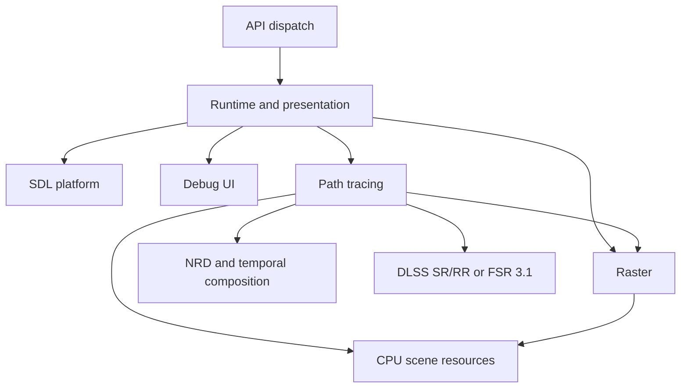

# Source organization and maintenance

Remix retains the 0.1003 public SDK and exposes two native rendering backends. Raster
is the default; tracing shares validated scene resources and composes with raster
world effects and UI. This document maps implementation ownership; behavioral
contracts remain in [API behavior](api.md), [raster](raster-renderer-design.md), and
[path tracing](path-tracing.md).

## Feature ownership

First-party runtime code lives under `src/native`. Each feature keeps its implementation
and private headers together. Tests mirror these features under `tests`.

| Folder | Owns |
| --- | --- |
| `api` | SDK interface assembly, exported functions, API serialization, callbacks, game values, and compatibility stubs |
| `runtime` | Startup/shutdown, Vulkan device and swapchain lifecycle, frame presentation, backend selection, settings registry, profile persistence, and screenshots |
| `scene` | CPU resource validation and lifetime, types/math, texture decoding, materials, meshes, cameras, instances, lights, and submitted UI geometry |
| `raster` | GPU uploads and caches, allocation, pipelines, draw preparation, recording, and raster shaders |
| `pathtrace` | Acceleration allocation, geometry cache, BLAS builds/compaction, TLAS builds/refits and policy, frame preparation/accumulation, rasterized primary G-buffer/depth passes, optional SHARC cache ownership/update/resolve/query, dispatch, and tracing shaders |
| `denoise` | Independent REBLUR SH / local radiance / SIGMA instances, dispatch binding, texture pools, per-dispatch constants, confidence filtering, SH resolve, sun visibility resolve, TAA and temporal diagnostics |
| `upscale` | NGX SR/RR and FSR 3.1 contexts, input preparation, reconstruction history, display composition and timing |
| `platform` | SDL windows/surfaces, events, input state, and key/button translation |
| `ui` | ImGui integration, tab components, profile dialogs, and unsaved-action controller |

Headers are included by feature, such as `scene/resources.h`. Vendor headers use
Meson's system include directories; first-party files do not traverse vendor trees
with relative includes. Public ABI headers remain in `public/include/remix`.

## Dependencies and ownership



The scene library has no Vulkan or SDL dependency. Raster and tracing are separate
internal static libraries. Tracing uses raster's existing sampled-material interface
to share GPU textures. This organization keeps the existing ownership model:
`RasterRenderer` derives from `NativeResources`, and the runtime owns the raster
renderer and an optional tracer. A backend's private `gpu.h` declares its state;
method definitions live in focused implementation files.

API process state has exactly one definition in `api/state.cpp`. The API mutex
serializes CPU submissions. Only the startup thread touches GPU state. Callback
invocation stays outside the API lock where the existing re-entry contract requires
it. Device loss, process-exit cleanup, and resource teardown order remain centralized
in the runtime lifecycle.

Presentation uses two submission slots, each with its own fence, acquire semaphore
and command buffer. CPU-written buffers, mutable descriptor sets, query pools,
readbacks, and retired resources follow the slot's fence. Removed meshes, materials
and textures remain alive until pending submissions finish using them. Present
semaphores remain associated with swapchain images. `REMIX_FRAMES_IN_FLIGHT=1`
selects one active slot for diagnostic comparisons; the default is two.

Path-tracing geometry and staging uploads recycle buffer allocations after their
final owner releases them through the existing slot retirement. A per-tracer cache
holds at most 512 idle buffers and 64 MiB of allocated memory, matching usage flags,
host visibility and size before reuse. Cache overflow uses ordinary destruction;
the last buffer owner also keeps the cache alive through tracer cleanup. Targets,
acceleration-structure arenas and persistent per-slot buffers use their existing
allocation paths.

Presented screenshots retain their capture fence and complete by the following
presentation when that fence becomes available within the bounded wait. Input
event polling checks capture readiness without waiting.

GPU-only targets, temporal images and acceleration structures stay shared. An
execution and memory barrier orders successive submissions on the same queue, so
the CPU can prepare the next frame while the GPU renders the current one. Preserve
the order of completed-slot retirement, BLAS work, TLAS work, ray queries,
composition, and raster overlays. Shared target, backend and post-processing
replacement drains pending GPU work. NRD descriptors and constants follow the
submission slot; FSR uses its SDK's internal frame resource ring.

Primary G-buffer and stable-depth visibility use reversed clip depth with a
greater-or-equal depth test. `NativeResources` forms the reversed projection row
before combining it with the view matrix, preserving separation between close
layers such as biome-tinted grass overlays. Depth written to the color guides
and final composition remains in the public camera's forward 0..1 convention,
so raster gameplay feedback and reconstruction keep their existing inputs.

NRD's integration boundary removes the Vulkan framebuffer Y flip from both
current and previous projection matrices. NRD reconstructs positions and projects
history with its own clip-to-image Y conversion. Motion vectors and jitter are
already in top-left image coordinates and retain their signs; the shared Vulkan
camera matrices used by tracing, TAA and upscaling remain unchanged.

`MaterialInfoEmissionEXT::suppressLightGeneration` separates a material's visible
emission from automatic area-light generation. Scene preparation skips its area
emitters while retaining the emissive color and texture for both primary visibility
paths. Explicit analytic lights are independent. The default remains visible and
light-emitting; material replacement and temporal signatures include the policy.

Tracing prepares CPU scene snapshots before waiting for the reused submission
slot's fence. `scene/trace_frame` groups and validates instances, samples one animation
time for the frame, reduces emissive textures, and constructs area emitters. Its
snapshots own the referenced CPU resources and contain no GPU handles. Texture
channel conversion and quadrature weights are shared immutable lookup tables;
material reduction caches still follow texture snapshot lifetimes. Emission filtering
and light hierarchy updates operate on staged copies before the fence. The hierarchy
caches identity ordering and emitter area, then refits only branches affected by
radiance animation. Each slot uploads a light family when its saved generation
differs from the staged hierarchy. GPU uploads, resource retirement, and committing
staged lighting remain after the fence. A skipped presentation discards its prepared
snapshot; enabling tracing prepares the first snapshot after backend initialization.

## Builds and generated files

Use `_work/build/<configuration>`, `_work/deps/<platform>`,
`_work/packages/<platform>`, and `_work/reports/<run>` for local output. These are
ignored. Meson's pinned SDL fallback additionally manages its source/cache under
`subprojects`; retain the tracked `SDL3.wrap`. Explicit script output arguments
continue to support external build directories.

Track architecture and feature documentation only. `.gitignore` allows the existing
guides and the `docs/architecture/` and `docs/features/` folders; add any new
standalone architecture/feature guide to that allowlist. License notices stay
tracked. Test results, verification reports, benchmark data, deployment records
and screenshots belong under ignored `_work/reports/<run>`. Legacy reports under
`docs/` remain local and ignored. Tracked guides should describe behavior and
validation procedures without linking to local reports.

Normal platform entry points live under `scripts/<platform>`. Shared dependency
building and packaging live under `scripts/common`. These replace the former
platform forwarding scripts. Build the shared library from `src/native/meson.build`
to preserve its build-relative location and packaged SDK/library names.

Readable shaders and `shaders/embedded.h` live inside each renderer feature. Use:

```sh
python3 scripts/shaders/generate.py all --check
python3 scripts/shaders/generate.py all --validate
```

Omit the flag to regenerate, or select `raster`, `pathtrace`, `denoise` or `nrd`. Regeneration uses
`glslangValidator`, pinned DXC and SPIR-V Tools; see [shader toolchain](shader-toolchain.md). Validation alone uses `spirv-val`. These tools are
optional for normal builds. Do not hand-edit generated shader arrays.

Vulkan probes and their shaders/platform runners are in `tools/vulkan-probes`.
Experimental driver pins, patches, and builds are in `tools/moltenvk`; the macOS
probe accepts separate `--deps` (SDL3) and `--driver` (experimental MoltenVK) outputs.
Normal macOS packages continue to use SDK MoltenVK.

## Making changes

Put code and tests under the feature that owns the behavior. Add explicit source
entries to that feature's Meson file. Avoid catch-all utility modules and dependencies
from scene code back into a GPU backend. Preserve public structures, calling
conventions, exports, and compatibility stubs; private exports/dispatch declarations
belong under `api`, not in the public SDK.

Use two-space indentation and attached braces. The repository `.clang-format` applies
to maintained first-party C/C++ code; do not format public SDK baselines, vendor files,
or generated shaders. Run the normal tests after changes and GPU/validation checks
when lifecycle, uploads, synchronization, or rendering changes. Platform commands and
limitations are described in [platforms](platforms.md).

Historical local reports and archived evidence preserve their original measurements and
source-path references. Existing artifacts were archived outside this checkout during
the organization change, with SHA-256 manifests and restoration instructions. Git
history, linked worktrees, `ref/`, and external symlink targets were preserved. Restoring
an old build can require its original absolute paths and source revision; archives
are not active dependency prefixes.

## Configuration ownership

`runtime/settings` defines the CPU-only requested snapshot and common validation /
serialization registry. API calls, profile loads, and UI edits use this registry.
`runtime/profiles` owns the current and saved snapshots, transactional file loading,
atomic saves, selection state, and independent panel preferences. Plain trace and
upscaler option types do not depend on GPU headers.

UI drawing edits a draft and commits it to the profile session. The runtime copies
the requested snapshot before the next frame's scene preparation. Effective backend
selection is separate, so unsupported devices and initialization failures preserve
the request. Existing backend and temporal-history synchronization remains in the
presentation and feature paths. Profile startup restoration precedes subsequent API
overrides. See [configuration profiles](features/configuration-profiles.md) for the
file format and user workflow.
