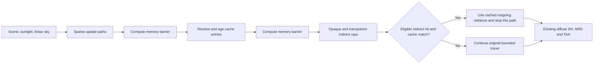

# SHARC radiance cache

The optional NVIDIA SHARC path shares surface radiance between indirect rays on
legacy diffuse and rough EON/GGX PBR materials. The pinned, unmodified SDK is **1.8.3.0**, revision
`4e21b585c33c83d723ca9a1e11bbb1090d145793`, copied from the local reference checkout
into `third_party/sharc`. Its license and NVIDIA attribution accompany packages.
No network dependency or shader compiler is required by ordinary builds.

## Rendering contract

Update launches one independent path per downscale tile, rotating through every
pixel in the tile over time. Stochastic selection of primary transparent sheets
also trains indirect surfaces visible through water's diffuse lighting, including
underwater views whose opaque primary guide is sky. Updates use the same robust
ray origins, alpha cutout decisions, tinted transmission, sun shadow rays and
uniform linear sky as the main tracer. `SharcInit`, `SharcUpdateHit`,
`SharcSetThroughput` and `SharcUpdateMiss` follow the SDK contract: each throughput
update supplies **the current segment's** reflectance or transmission.

Opaque **static legacy diffuse** and **rough PBR** surfaces own cache entries.
PBR entries require sampled perceptual roughness of at least 0.5, including metals
and normal-mapped surfaces. Sharper surfaces, moving surfaces and blended sheets
still affect visibility and lighting along update paths; their own outgoing
radiance is never stored or queried. Mapped shading normals participate in the
cache's orientation key.

The SDK's directional encoding stores luminance L0/L1 and chroma L0. PBR specular
energy supplies the directionality weight, reduced for broader rough lobes;
diffuse energy remains isotropic. Both training and lookup supply the outgoing
direction toward the previous path vertex. The cache uses combined diffuse and
specular material factors (the same NRD approximation used by NVIDIA's sample)
for PBR demodulation, with a positive floor. Legacy diffuse retains
`max(albedo, 0.001)`. Dark dielectrics keep their nonzero Fresnel reflection, and
metal tint participates in demodulation. This is a spatial and angular
approximation, not an exact replacement for a direction-dependent BRDF.

When the entire traced scene has no eligible receivers, cache update, resolve and
counter readback work stop automatically. Off-screen static legacy receivers
still count. Tracing selects the ordinary uncached shader while no receiver is
eligible, removing unused hash-grid code from the shader. Roughness textures are
potential receivers at scene preparation; individual ray hits check sampled
roughness. Sampling budgets and
the denoiser confidence pass remain active; cache debug views retain their
specialized shader. Returning receivers trigger cache initialization
and warmup before reuse. During an idle period, update/query/occupancy counters
and update/resolve times are zero, timing availability is false, and cache
rendered-frame counts stop; `active` still reports that SHARC is available and
enabled. Allocated cache storage is retained for reuse. F12 labels this state
**Enabled (idle)** and shows **Caching** when update paths are reported.

The production query path keeps the existing Lambert or EON/GGX sampling and
mixture PDFs. It queries only subsequent eligible hits, after any intervening
transmission. The path footprint must exceed the cache voxel's diagonal.
Legacy diffuse uses segment length; PBR uses the narrower GGX cone from the SHARC
integration guide, capped at the legacy footprint. The mixture estimator carries
both lobes along one ray, so this conservative test also applies to its diffuse
share. Zero-roughness reflections keep tracing, while a later rough bounce can
reach the cache. Cache hits must have
more than three accumulated samples and finite radiance. A hit contributes
`throughput * cachedOutgoingRadiance` exactly once. Its direct light is already
included in the cached value. Primary direct light and visible raster sky remain
independent of the cache.

The explicit update and fallback loops retain the configured bounce and sheet
limits. SDK cache resampling propagates a temporally averaged lighting tail that
can include more diffuse interactions than a finite uncached path. SHARC is an
approximation, with spatial and temporal bias; use progressive accumulation or
`sharc=0` for the original bounded reference. Zero indirect bounces disables the
cache and all indirect illumination.

## Ownership, synchronization and temporal behavior

The tracer owns three device buffers with SDK strides of 8, 32 and 24 bytes for
hash keys, directional atomic accumulation and resolved native-fp16 data.
Capacity defaults to `2^22` entries (256 MiB plus two small diagnostic buffers).
CPU allocation and every update/resolve/query shader use the same directional
representation. Device addresses use the private CPU/GLSL frame layout; public
ABI layouts and function tables are unchanged.

Initialization clears all three buffers. Transfer-to-compute, update-to-resolve,
resolve-to-query and next-frame reuse dependencies cover every buffer access.
Resolve runs one invocation per entry. Adjacent-level blending and collision
history borrowing are disabled to avoid cross-entry reads during in-place
resolve; newly encountered levels warm through ordinary cache misses. Resolve
clears accumulation entries and evicts stale entries. Diagnostics copy to a
separate host buffer; the CPU reads only after the submission fence and mapped
memory invalidation. Temporal pipelines follow the NRD layout lifetime, and
resize/destruction runs after the existing frame fence.

World/reset epochs, origin rebases, resize, capacity/scale/bounce changes, static
geometry changes and explicit reset clear the cache. Large light cuts clear only
the cache. Ordinary sky/sun changes and moving occluders shorten cache averaging
to four frames for a responsive interval, without clearing NRD/TAA history.
Animated atlas uploads do not globally clear the cache or temporal history.
Primary motion/depth/normal guides and diffuse SH packing retain their original
meaning. The previous-seed lighting confidence dispatch follows the same cache
query policy as current shading. Cache convergence requests additional world
renders through tracing statistics; converged UI redraws can reuse world output.

## Controls and fallback

Meson `-Dsharc=true` is the default; `-Dsharc=false` builds the original tracing
path without SHARC shader pipelines. Runtime support additionally requires
`shaderFloat16`, `storageBuffer16BitAccess` and `shaderBufferInt64Atomics`. Missing
features or optional cache allocation/pipeline failure retain uncached tracing
and report an unavailable reason. Toggling SHARC off and on retries initialization.

All keys below are under `rtx.native.pathtrace.`:

| Key | Default | Values |
| --- | --- | --- |
| `sharc` | true | Boolean; enable the cache |
| `sharcDebug` | false | Boolean; show visible cached radiance, magenta on a miss; bypass NRD/TAA |
| `sharcReset` | — | Set to `1` to request one cache reset |
| `sharcCapacityLog2` | 22 | 16–22; entry capacity is a power of two |
| `sharcDownscale` | 5 | 1–16; one update path per tile |
| `sharcSceneScale` | 50 | 1–200; larger values produce finer voxels |
| `sharcAccumulationFrames` | 32 | 1–1024 |
| `sharcStaleFrames` | 64 | 8–1024 |

The Remix debug panel provides enable, reset, cache view, scale and update-density
controls with occupancy, memory, sampled query-hit rate and separate update /
resolve timings. Query counters sample 1/64 of pixels and exclude confidence
retracing; they are **not total ray counts**. The additive optional export
`remixapi_GetSharcStatisticsEXT` exposes these diagnostics.

BetaRT accepts `MCRTX_PT_SHARC`, `MCRTX_PT_SHARC_DOWNSCALE`,
`MCRTX_PT_SHARC_SCALE`, `MCRTX_PT_SHARC_CAPACITY_LOG2` and `MCRTX_PT_SHARC_DEBUG`.
The matched JNI optionally loads the diagnostic export. Its CSV retains existing
columns and adds `sharc_sampled_queries` / `sharc_sampled_hits`; unavailable
full-ray counters and unrelated systems remain explicitly unavailable. The
Java/JNI transport is unchanged by cache support.

Shader permutations use `SHARC_UPDATE_PASS=1` or `SHARC_QUERY=1`, with the existing
`TEMPORAL`, `TRANSPARENCY_PASS` and `CONFIDENCE_PASS` permutations. Shared SDK
configuration sets GLSL support, directional encoding, material demodulation and cache resampling.
The separate resolve shader uses the same cache representation.

## Reference sources and visual checks

The local [SHARC integration guide](../../../reference/denoisers/SHARC/docs/Integration.md)
and [NRD-Sample update shader](../../../reference/NRD-Sample/Shaders/SharcUpdate.cs.hlsl),
[resolve shader](../../../reference/NRD-Sample/Shaders/SharcResolve.cs.hlsl) and
[indirect query integration](../../../reference/NRD-Sample/Shaders/TraceOpaque.cs.hlsl)
provide the concrete SDK flow and cache-hit policy.

[Ray Tracing Gems I](../../../reference/ray-tracing-gems/book.md), chapters 6,
15–16 and 32, informs robust origins, Monte Carlo sampling and decoupled cached
shading with ordinary shading on misses. Chapter 32 describes a different cache,
not SHARC. [Ray Tracing Gems II](../../../reference/Ray-Tracing-Gems-II/book2.md),
chapters 14, 20 and 50, informs the reference tracer, linear accumulation,
direct-light sampling and separate transparent composition.

Compare cache on/off and progressive reference in an exposed scene, an enclosed
room and a room with an opening. Include moving occluders, cutouts and tinted
sheets. Exercise both primary-visibility modes, sky/zero-bounce controls, world
reload/rebase and NRD/TAA, then use cache view and occupancy to confirm actual
reuse. Smaller voxels reduce sharing and may reduce leaks; larger voxels increase
sharing and potential bias. Cache updates and resolve have a fixed cost, so
simple scenes can be slower even with a high hit rate. Assess total GPU/frame
cost as well as noise and lighting quality before tuning update density.

For controlled static-view profiling, `REMIX_PROFILE_EVERY_FRAME=1` bypasses
reuse of the fully converged output image. It preserves camera, history and cache
state and runs fresh lighting for every submitted world frame. This diagnostic
is off by default; keep the same setting for both sides of a comparison. The
ordinary presentation/fresh-packet counters alone do not prove lighting ran:
use `REMIX_STACK_PROFILE` in separate diagnostic runs to verify GPU dispatches.
The overall trace timer includes SHARC update/resolve; do not add them again.
Disabled caches retain allocations and their last timing/counter values; report
zero cache work for an inactive frame instead of treating those values as new work.

At one indirect bounce, a query still needs the first continuation intersection.
A hit can replace that surface's lighting evaluation and visibility rays, but
cannot eliminate an additional continuation segment. Also, automatic separate
indirect dispatch currently excludes SHARC queries. Profile both cache maintenance
and opaque lighting: a cache on/off comparison can change dispatch strategy as
well as the number of rays. `REMIX_SPLIT_INDIRECT=0/1` selects inline/forced split
for controlled diagnostics in supported modes; leave this override unset for
ordinary automatic selection. Compare image quality and repeated timings before
choosing a dispatch policy.

`REMIX_TRACE_STATE=path.csv`, together with `REMIX_STACK_PROFILE`, records the
completed frame's selected pipelines, specialization keys, scene-table hash,
buffer/TLAS addresses and private frame-uniform bytes beside opaque GPU time.
State follows submission slots so it describes the timed dispatch, not the next
frame being prepared. The stage CSV's `prepare_ms` covers GPU work between AS
build completion and the trace timer, including staged scene uploads.

With `REMIX_PROFILE_EVERY_FRAME=1`, the diagnostic `REMIX_INDIRECT_MODE_FILE`
can name a file containing `0` (inline), `1` (split) or `a` (automatic). It is read
when `sharcReset` changes; atomically replace it before requesting the reset.
This permits alternating dispatch modes within one loaded fixture process.
An optional `,0` or `,1` also selects host or device-local scene tables; placement
changes replace each submission slot's buffers only after its completion fence.

`REMIX_DEVICE_LOCAL_SCENE=1` experiments with GPU-local material and light tables.
The material table is staged per submission slot; light tables are uploaded when
their generation changes. It leaves lighting and sampling unchanged, adds staging
storage and transfer work, and is disabled by default. Assess full frame time as
well as trace time, because the scene transfers occur before the trace timer.
