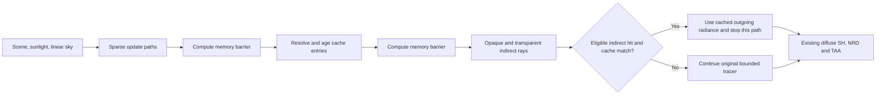

# SHARC diffuse radiance cache

The optional NVIDIA SHARC path shares diffuse surface radiance between indirect
rays. The pinned, unmodified SDK is **1.8.3.0**, revision
`4e21b585c33c83d723ca9a1e11bbb1090d145793`, copied from the local reference checkout
into `third_party/sharc`. Its license and NVIDIA attribution accompany packages.
No network dependency or shader compiler is required by ordinary builds.

## Rendering contract

Update launches one independent path per downscale tile, rotating through every
pixel in the tile over time. Stochastic selection of primary transparent sheets
also trains indirect surfaces visible through water's diffuse lighting, including
underwater views whose opaque primary guide is sky. Updates use the same robust
ray origins, alpha cutout decisions, tinted transmission, sun shadow rays and
uniform linear sky as the main tracer. `SharcInit`, `SharcUpdateHit`,
`SharcSetThroughput` and `SharcUpdateMiss` follow the SDK contract: each throughput
update supplies **the current segment's** reflectance or transmission.

Only opaque **static** surfaces own cache entries. Moving surfaces and blended
sheets still affect visibility and contribute lighting along update paths. Their
own surface radiance is never stored or queried. Geometry normals select the
cache orientation. Material demodulation uses `max(albedo, 0.001)` so queried
radiance retains local texture detail and black materials cannot divide by zero.

The production query path starts from the existing primary surface and samples
its cosine hemisphere exactly as the reference tracer does. It queries only
subsequent diffuse hits, after any intervening transmission. The distance from
the previous diffuse vertex must exceed the cache voxel's diagonal. Every traced
lobe is currently Lambertian, so its diffuse footprint is wider than this bound;
future sharp specular lobes need a separate footprint test. Cache hits must have
more than three accumulated samples and finite radiance. A hit contributes
`throughput * cachedOutgoingRadiance` exactly once. Its direct light is already
included in the cached value. Primary direct light and visible raster sky remain
independent of the cache.

The explicit update and fallback loops retain the configured bounce and sheet
limits. SDK cache resampling propagates a temporally averaged lighting tail that
can include more diffuse interactions than a finite uncached path. SHARC is an
approximation, with spatial and temporal bias; use progressive accumulation or
`sharc=0` for the original bounded reference. Zero indirect bounces disables the
cache and all indirect illumination.

## Ownership, synchronization and temporal behavior

The tracer owns three device buffers with SDK strides of 8, 16 and 16 bytes for
hash keys, atomic accumulation and resolved native-fp16 data. Capacity defaults
to `2^22` entries (160 MiB plus two small diagnostic buffers). Device addresses
are appended to the private 336-byte CPU/GLSL frame layout; existing public ABI
layouts and function tables are unchanged.

Initialization clears all three buffers. Transfer-to-compute, update-to-resolve,
resolve-to-query and next-frame reuse dependencies cover every buffer access.
Resolve runs one invocation per entry. Adjacent-level blending and collision
history borrowing are disabled to avoid cross-entry reads during in-place
resolve; newly encountered levels warm through ordinary cache misses. Resolve
clears accumulation entries and evicts stale entries. Diagnostics copy to a
separate host buffer; the CPU reads only after the submission fence and mapped
memory invalidation. Temporal pipelines follow the NRD layout lifetime, and
resize/destruction runs after the existing frame fence.

World/reset epochs, origin rebases, resize, capacity/scale/bounce changes, static
geometry changes and explicit reset clear the cache. Large light cuts clear only
the cache. Ordinary sky/sun changes and moving occluders shorten cache averaging
to four frames for a responsive interval, without clearing NRD/TAA history.
Animated atlas uploads do not globally clear the cache or temporal history.
Primary motion/depth/normal guides and diffuse SH packing retain their original
meaning. The previous-seed lighting confidence dispatch follows the same cache
query policy as current shading. Cache convergence requests additional world
renders through tracing statistics; converged UI redraws can reuse world output.

## Controls and fallback

Meson `-Dsharc=true` is the default; `-Dsharc=false` builds the original tracing
path without SHARC shader pipelines. Runtime support additionally requires
`shaderFloat16`, `storageBuffer16BitAccess` and `shaderBufferInt64Atomics`. Missing
features or optional cache allocation/pipeline failure retain uncached tracing
and report an unavailable reason. Toggling SHARC off and on retries initialization.

All keys below are under `rtx.native.pathtrace.`:

| Key | Default | Values |
| --- | --- | --- |
| `sharc` | true | Boolean; enable the cache |
| `sharcDebug` | false | Boolean; show visible cached radiance, magenta on a miss; bypass NRD/TAA |
| `sharcReset` | — | Set to `1` to request one cache reset |
| `sharcCapacityLog2` | 22 | 16–22; entry capacity is a power of two |
| `sharcDownscale` | 5 | 1–16; one update path per tile |
| `sharcSceneScale` | 50 | 1–200; larger values produce finer voxels |
| `sharcAccumulationFrames` | 32 | 1–1024 |
| `sharcStaleFrames` | 64 | 8–1024 |

The Remix debug panel provides enable, reset, cache view, scale and update-density
controls with occupancy, memory, sampled query-hit rate and separate update /
resolve timings. Query counters sample 1/64 of pixels and exclude confidence
retracing; they are **not total ray counts**. The additive optional export
`remixapi_GetSharcStatisticsEXT` exposes these diagnostics.

BetaRT accepts `MCRTX_PT_SHARC`, `MCRTX_PT_SHARC_DOWNSCALE`,
`MCRTX_PT_SHARC_SCALE`, `MCRTX_PT_SHARC_CAPACITY_LOG2` and `MCRTX_PT_SHARC_DEBUG`.
The matched JNI optionally loads the diagnostic export. Its CSV retains existing
columns and adds `sharc_sampled_queries` / `sharc_sampled_hits`; unavailable
full-ray counters and unrelated systems remain explicitly unavailable. The
Java/JNI camera transport remains protocol v5.

Shader permutations use `SHARC_UPDATE_PASS=1` or `SHARC_QUERY=1`, with the existing
`TEMPORAL`, `TRANSPARENCY_PASS` and `CONFIDENCE_PASS` permutations. Shared SDK
configuration sets GLSL support, material demodulation and cache resampling.
The separate resolve shader uses the same cache representation.

## Reference sources and visual checks

The local [SHARC integration guide](../../../reference/denoisers/SHARC/docs/Integration.md)
and [NRD-Sample update shader](../../../reference/NRD-Sample/Shaders/SharcUpdate.cs.hlsl),
[resolve shader](../../../reference/NRD-Sample/Shaders/SharcResolve.cs.hlsl) and
[indirect query integration](../../../reference/NRD-Sample/Shaders/TraceOpaque.cs.hlsl)
provide the concrete SDK flow and cache-hit policy.

[Ray Tracing Gems I](../../../reference/ray-tracing-gems/book.md), chapters 6,
15–16 and 32, informs robust origins, Monte Carlo sampling and decoupled cached
shading with ordinary shading on misses. Chapter 32 describes a different cache,
not SHARC. [Ray Tracing Gems II](../../../reference/Ray-Tracing-Gems-II/book2.md),
chapters 14, 20 and 50, informs the reference tracer, linear accumulation,
direct-light sampling and separate transparent composition.

Compare cache on/off and progressive reference in an exposed scene, an enclosed
room and a room with an opening. Include moving occluders, cutouts and tinted
sheets. Exercise both primary-visibility modes, sky/zero-bounce controls, world
reload/rebase and NRD/TAA, then use cache view and occupancy to confirm actual
reuse. Smaller voxels reduce sharing and may reduce leaks; larger voxels increase
sharing and potential bias. Cache updates and resolve have a fixed cost, so
simple scenes can be slower even with a high hit rate. Assess total GPU/frame
cost as well as noise and lighting quality before tuning update density.
